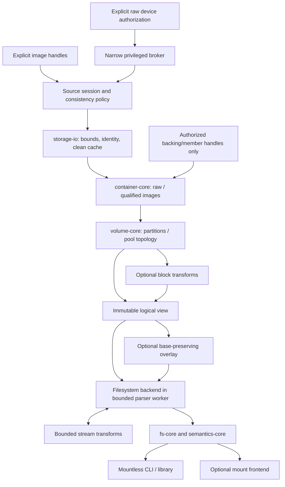
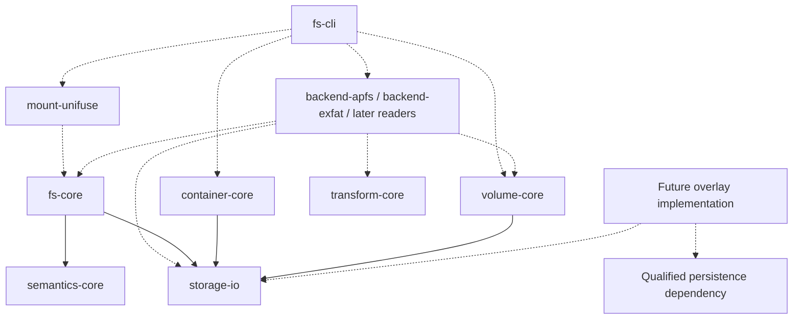
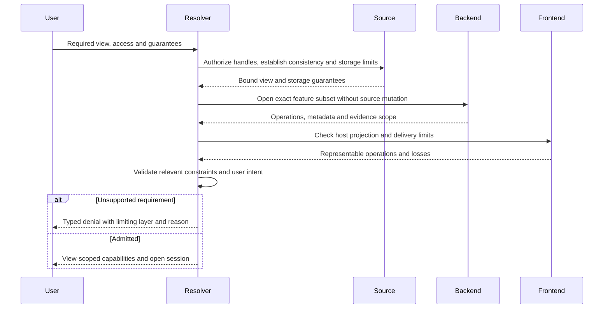

# Dioryx — design

Version 0.3 planning revision, 15 November 2026. This specifies the next architecture;
only the six-crate seed and the verbatim source declarations below are implemented.
No new dependency, backend, parser worker, overlay or mount is enabled by this document.

## 1. Decisions, scope and alternatives

We own project interfaces, semantic projection, source authority, evidence and
cross-platform qualification. Reuse qualified format engines; do not assume that
exFAT mutation, an overlay database or a shared block layer must be reinvented.
Keep mountless read-only delivery independently shippable. This is not a new
on-disk filesystem, kernel driver or general-purpose database.

The working seed contains a read-only regular-file device, bounded raw/volume
views, identity transforms, lossless names and core interfaces. Its FileDevice
serializes seek/read and depends on externally immutable input. The minimal
capability mask and metadata do not yet implement the richer contracts below.
New interfaces are added in the smallest consuming track-001 increment; the direct upstream reader proof may precede the VFS adapter; this revision
leaves the Rust declarations, Cargo manifests and lockfile unchanged.

| Decision | Selected direction | Rejected or conditional alternative |
| --- | --- | --- |
| D01 | Pinned official Conductor and a single context/track index | No parallel agent-specific plans or audit hierarchy |
| D02 | Synchronous object-safe core, bounded frontend workers, independent reader cursors | No mandatory async trait rewrite; Tokio is not a parser sandbox |
| D03 | Project-owned guarantees and typed uncertain write outcomes | No generic block batch pretending filesystem crash atomicity |
| D04 | One clean-cache policy per logical address space; one serialized dirty owner | Moka or an upstream cache only after measurement; no stacked write-back caches |
| D05 | Raw-name identity and native comparison, explicit host projection | NFC/NFD display names never become universal lookup keys |
| D06 | Narrow qualified readers first; compare full engines before custom mutation | No unconditional adoption of rust-fs-core or any single package family |
| D07 | Dependencies and delivery profiles admitted per feature/target/version | No blanket zero-unsafe or format-wide claims |
| D08 | Immutable/captured source views for coherent reads and overlay bases | Read-only file mode or an advisory lock alone does not establish a snapshot |
| D09 | Base-preserving overlay using a qualified existing storage engine | No new WAL/B-tree by default and no raw-device overlay merge in MVP |
| D10 | Handle-based extraction and explicit backing-resource resolver | No ambient path/URL/device opens derived from image metadata |
| D11 | Low-privilege parser worker; narrow raw-device broker | Mount authority does not imply physical-disk write authority |
| D12 | Genuine native fixtures plus independent, provenance-aware oracles | Two forks or packages sharing a parser are not independent implementations |

Considered approaches were a custom driver stack, wholesale adoption of a shared
filesystem framework, and a hybrid of narrow readers plus project-owned safety
adapters. Choose the hybrid: it limits maintained format code without outsourcing
our guarantees to a young framework. A compiled native-image comparison may
justify an upstream substrate; it is not a prerequisite to the first APFS read.

## 2. Runtime composition and authority

The diagram is runtime data flow, not the Cargo dependency graph. Components
other than the six existing core crates describe future work.



Optional layers may recur in format-dependent order. Whole-disk encryption can
precede partitioning; partition encryption follows it; APFS object encryption and
file compression occur within the format implementation. UDIF decompression is
not file-content decompression. An APFS storage container is a pool, not a UDIF
container. Never force a universal fixed pipeline or apply transforms twice.

A SourceSession binds approved handles, ranges, access, geometry and consistency.
A planned ViewId binds source capture identity, selected partition/pool members,
filesystem checkpoint/snapshot and overlay generation. Device path, UUID or a
single metadata checksum alone does not prove content immutability. Raw device
removal/replacement, geometry drift and stale sessions revoke access.

Coherent mode requires a verified immutable image/capture, native snapshot or
qualified exclusive ownership. A best-effort live read is an explicitly labeled
mode without coherent export/forensic guarantees; its results cannot be presented
as a point-in-time image. The initial FileDevice is not upgraded by documentation.
A changing base cannot be made coherent merely by adding an overlay or cache.

Backing-file names and pool member IDs are untrusted requests, not authority.
The composition root supplies authorized handles and ranges through a resolver.
No implicit relative/absolute path opens, network URLs or device scans. Detect
cycles, duplicate/aliased members, incompatible geometry and missing members.
Represent missing/degraded topology explicitly; do not turn a multi-device pool
into an apparently complete linear volume. Allow degraded reads only where the
backend's exact layout and recovery mode are qualified.

## 3. Cargo boundaries and dependency selection

Arrows mean depends-on; dotted edges are future dependencies, not new members.



Registries accept backend registrations from the composition root, rather than
pulling backend crates into core. Default features remain mountless; driver,
writer and platform profiles are explicit. Compile supported combinations rather
than treating --all-features as a meaningful universal target.

The substrate comparison is: existing seed plus standard positional I/O/small
adapters versus rust-fs-core's reusable devices/slices/cache. Preserve our public
contracts in both. Its documented library name fs_core collides with ours: any
admission must use a Cargo dependency alias, private to the adapter, and a compile
test. Upstream write_at/flush alone cannot supply serialized groups, uncertain
outcomes, exclusive ownership or crash guarantees. Audit buffering and cursor
semantics before choosing it. Do not add a second cache to hide the first.

NTFS/ext4 start with ntfs/ext4-view read-only qualification; full rust-fs-* engines
are competitors, not predetermined replacements. exFAT compares existing engines
before bespoke mutation. Keep external APIs and types out of public signatures,
and record each adapter's supported subset, maintenance cost and fallback.
Only admit a dependency at its first real, tested consumer. Candidate versions
and source evidence live in [dependency evidence](docs/dependency-evidence.md).

## 4. Storage, caching and resource contracts

BlockDevice reports exact logical/physical geometry and bounded positional reads.
Raw buffer-address, offset and length alignment are distinct. Logical sector size
is not a promise of atomic power-loss writes. Prefer standard positional I/O when
sufficient; qualify positioned-io or a substrate rather than duplicating cursor
and slice adapters. Short reads, Interrupted, truncation and hot-unplug stay typed.

WritableBlockDevice remains an explicit opt-in reachable through type erasure.
Read-only wrappers expose no writer and reduce capabilities. Before native raw
writes, broker admission establishes exact device identity, ownership, allowed
ranges and absence of conflicting OS mounts. Unsupported exclusivity denies writes.

The write owner validates generation, ranges, alignment, group overlap, payloads
and barrier support while holding the same serialization authority as submission.
A group completes its barrier before the next begins. Later groups may intentionally
rewrite earlier ranges. After possible partial I/O or cancellation, return an
indeterminate result, report only confirmed durability, fence the session and
invalidate dependent cache generations. No automatic retry, rollback promise or
claim that a disconnected worker's writes never happened.

A cache key includes address-space/view identity, transform position and generation,
not merely a disk offset. Fill completion verifies that the captured generation
is still valid. Dirty data belongs to one transaction owner outside eviction.
An upstream private cache must either be disabled or included in the same coherent
policy. Moka remains a candidate, not a hard-RSS enforcement mechanism.

One session budget governs nested readers, inflight payloads, decompressed output,
metadata indexes, handles, spool space and work/deadline limits. Child layers take
allowances from the parent, rather than each receiving a full independent quota.
Charge before allocation where possible; dependencies with unbounded allocations
need rejection, isolation limits or an upstream fix. Overflow is an error, not
saturation. Worker-process termination can bound a stuck parser; dropping a Tokio
future does not stop arbitrary blocking work. Cancellation cannot undo submitted
writes. Fault tests define where work is cancellable and where it becomes uncertain.

## 5. Four capability domains and semantics

The target design has four descriptors: StorageGuarantees, FilesystemOperations,
SemanticProjection and FrontendLimits. These names describe planned roles, not
Rust types already added to the seed. Each feature carries a reason/limitation,
scope (selected view and mode) and qualification reference. Limits use appropriate
relations: sizes, sets, mode constraints and guarantee prerequisites, not one
invented total ordering of all capabilities.



Reduction is monotone, but a neutral container must not erase a backend's xattrs
simply because it knows nothing about them. No durability guarantee survives a
layer that cannot persist writes. Read-only request intent strips every mutation
entry point; a runtime failure may further reduce access but never silently enable
it. A frontend must reject a required unrepresentable operation rather than report
success while discarding data or a flush error.

Visibility-atomic rename, durable completion and crash-atomic recovery are distinct.
A guarantee is specific to direct or overlay mode. A transactional overlay may
provide stronger behavior only when the entire logical operation maps into one
qualified transaction. An arbitrary sequence of block writes is not automatically
one filesystem transaction. Never copy overlay guarantees onto direct exFAT writes.

Stable nodes are identified by view and on-disk object identity, not path hashes.
Open handles, directory cookies and node IDs have separate lifetimes. Implement
unlink-while-open, hardlinks, rename, stale generations and bounded handle tables.
A generational-map dependency can help with ephemeral handles; it cannot create
persistent inode identity. Identifier exhaustion must fail rather than wrap.

Preserve RawName::Bytes/Utf16 and format-native collation. NFC/NFD is presentation.
Handle Windows reserved names, stream delimiters, trailing dots and projection
collisions explicitly. Default export fails rather than overwrites; opt-in mappings
are reversible and recorded. Complete timestamps retain precision, raw encoding
and unknown/local offsets. Stored ACL/SID data, synthesized POSIX permissions and
unavailable metadata remain distinguishable; no implicit ACL equivalence.

## 6. Engine reuse and exFAT write qualification

Track 003 first compares fs-pc/fs_pc, fstool, embedded-exfat and any justified
alternative against the same corpus. ferrosys is a possible formatter/oracle
candidate, not a substitute for native fixtures. Source provenance, exact manifests,
features, safety and licensing must be resolved before any winner is selected.
Self-reported capabilities and native-checker claims are test hypotheses.

Choose a thin adapter if a candidate meets the contracts. Otherwise prefer a
bounded upstream fix; implement local mutation only for a demonstrated gap and
retain independent read/native oracles. The evaluation itself must not import an
entire CLI/UI framework into the core or relax unsafe and durability requirements.

Every writer must validate boot regions, geometry, active FAT, bitmap/upcase tables,
entry checksums and supported flags. Unsupported TexFAT, dirty/corrupt structures
or unknown features deny direct write access. One owner coordinates allocation,
initialization, FAT relationships, directory publication and freeing. Preserve
valid-data length, zero initialization, NoFatChain transitions and rename reachability.
Exact ordering comes from format evidence and fault tests, not this outline.

Persist dirty state and dependency ordering as required; clear it only after the
qualified completion protocol. Native fsck cleanliness alone is insufficient:
compare acknowledged content/metadata and recovery results at every fault cut.
Check interrupted images before repair and preserve failing copies. Ordinary
exFAT does not gain a portable journal because a sidecar or overlay exists.
NTFS/ext4 write engines may be evaluated in 004 but stay outside MVP write claims.

## 7. Overlay, recovery and export

An overlay has two independent obligations: never change its base and recover its
own committed state. Compare a redb-backed changed-block map with one qualified
existing virtual-disk engine. redb is a storage candidate, not a new universal
runtime dependency. Test commit durability, platform behavior, memory, disk-space
amplification and random-write workload before selecting it. No bespoke database
or WAL is justified by a desire to avoid evaluating an existing one.

Store overlay identity, schema version, base capture/geometry, logical size and
block payload/index changes coherently. A database-based implementation commits
those items in the same transaction; an image-engine implementation must establish
an equivalent recovery invariant. Base matching needs a coherent capture plus
recorded identity/digests: hashing a live base once cannot freeze it. Reject wrong,
changed or missing bases, truncated payloads, unsupported schema and failed checksums.

Use bounded read-modify-write for partial blocks and preserve sparse/zero semantics.
Reopen and recovery cannot silently fall back to base data for an allocated but
corrupt overlay block. Test disk-full during allocation/commit, failed flush,
termination, torn writes and cleanup. Compaction/garbage collection preserves all
referenced durable generations and is separately qualified.

MVP output is a new image exported from a frozen view, verified before publication.
The original remains intact. Do not implement automatic overlay merge/commit to
raw media. Direct exFAT writes are a different explicitly admitted mode. An atomic
rename of a completed export file, where supported, does not imply multi-file or
whole-device atomicity.

Dirty-volume recovery is explicit. No parser may replay a journal or virtual-disk
log into a source opened for inspection. Refuse recovery-required input until a
format-qualified recovered overlay view exists. Native mount utilities may replay
metadata even on some read-only mount paths; qualification runs them on expendable
copies with before/after hashes. Later ext4/NTFS replay is an independent feature,
not a prerequisite for read-only clean-image support.

## 8. Hostile-input and extraction boundaries

Magic identifies candidates, not validity. Ambiguous/polyglot sources require
explicit resolution. Bounds, features, checksums and relationships are validated
before exposing a view; do not keep trying unrelated parsers until one returns
plausible output. Active-path cycles differ from shared subtrees; charge both depth
and total work. Fuzz all admitted parsers from their first integration.

For extraction, use cap-std/cap-tempfile candidates to replace ambient-path glue.
An approved destination directory capability scopes creation; temporary outputs
stay private and bounded. Reject or explicitly encode symlinks, reparse points,
unsafe types, host-name collisions and source aliases. Tests include concurrent
ancestor replacement and existing hardlinks to the source. Stage and publish
without following untrusted components; capability APIs do not themselves decide
overwrite, metadata or sandbox policies.

Separate the unprivileged parser worker from the privileged device broker. Grant
only approved handles/ranges and minimal read/write verbs, with bounded versioned
IPC, resource budgets and revocation. No arbitrary paths, network or process
execution via image metadata. Sandboxing is native and platform-specific; a safe
Rust API or catch_unwind is not process isolation. The broker enforces authority,
not filesystem correctness, so direct writes still require engine qualification.

First-party parser/format/VFS crates retain forbid(unsafe_code). Any dependency
unsafe/FFI remains visible in the admission record. OS FFI exceptions are narrow
and documented with SAFETY invariants and native tests. Preserve the current
safety policy; no dependency exception is granted by this revision.

## 9. Qualification and delivery

Use evidence states: advertised, source-reviewed, compiled, native-qualified and
fault-qualified. They are not one global badge: a candidate can qualify reads
while writes remain blocked. Evidence keys include package/source commit, Cargo
features, target, native runtime, filesystem features, view mode and fault model.
Shared maintainers, parser code and fixtures are common-mode risks; track provenance
before counting independent comparators.

Use the same deterministic operation traces and block fault schedules for all
writer candidates, plus native readback/checkers. proptest targets invariants;
Loom targets modeled synchronization; cargo-fuzz targets parsers. None substitutes
for the others or for genuine-image evidence. Native malformed-image tests belong
in disposable isolated hosts, not the user's live workstation.

Conductor 001 is the core prerequisite; 002 can deliver mountless APFS without
waiting for 005 or all of 006. Track 005 depends on core contracts, not the exFAT
writer it later tests. Track 006 starts corpus/qualification infrastructure early;
its final release phase joins the relevant feature gates. No cyclic whole-track
dependency may make the writer wait for tests that wait for the writer.

The [delivery plan](conductor/delivery-plan.md) refines this sequence into R0–R5 and per-profile gates. Only the contracts required by the next consumer are prerequisites.

The mandatory Cargo gate is unchanged for every completed task. The present
revision is authored but not Cargo-accepted in its editing runtime; see the
[revision record](conductor/tracks/track-001-workspace-and-core-traits/revision-0.3.md).

## 9a. Revision 0.3: delivery, authority and fault seams

[Dioryx](docs/identity.md) is the proposed working identity, not a new disk format.
The package namespace is planned but not yet applied; the declarations below still
match the original seed. Do not create an empty umbrella package or publish names.

The direct APFS native-reader proof precedes generic VFS integration. Minimal
read-only source/view/budget and read metadata contracts are separate from mounted
handle lifetimes, raw-device brokerage, storage migration, caching and write
sessions. Validate the read API with APFS and exFAT before treating it as stable.
Full original MVP gates remain required; earlier profiles have narrower claims.

Features include code; they do not grant authority. Cargo feature unification must
not upgrade a read-only session, even when writer support is compiled. Resolve
requested mode, source consistency, layer limits and frontend semantics explicitly.
A proposed/open/fenced/closed session lifecycle prevents retrying an uncertain write
as if it had no effect. Broker handles cannot regain permission after revocation.

In-process library callers own their isolation boundary. Hostile-image CLI profiles
require a qualified low-privilege parser worker. A privileged raw-device broker is
needed only for profiles requiring that authority, not for ordinary image reads.
Controlled fixture proofs are not advertised as a host sandbox.

Overlay evaluation must instrument both the logical block-operation interface and
the selected persistence engine's real I/O. A BlockDevice fault wrapper alone does
not intercept writes made directly by a store. Evaluate redb's StorageBackend and
Builder::create_with_backend at the selected version. Separate process termination
from simulated power loss, including the stated cache, reorder and torn-write model.

Metadata reports distinguish absent from unsupported. Content-only extraction
reports omissions; faithful extraction rejects a required unrepresentable field.
Compatibility evidence is profile-scoped and versioned. One profile becoming ready
does not complete another platform or the full track.

Primary sources: [Cargo feature unification](https://doc.rust-lang.org/cargo/reference/features.html),
[redb storage extension point](https://docs.rs/redb/latest/redb/trait.StorageBackend.html),
and [redb builder](https://docs.rs/redb/latest/redb/struct.Builder.html). Source
capabilities are candidates until pinned and exercised; they are not admission.

## 10. Executable Rust contracts


The following declarations are copied exactly from the compiled workspace source.
Their supporting types and implementations are in the named source files. The
contract checker rejects drift between these blocks and source. They specify
interfaces; the presence of a trait does not advertise a backend implementation.

<!-- BEGIN COMPILED CONTRACTS -->
### storage-io

Source: `crates/storage-io/src/lib.rs`.

```rust
pub struct Geometry {
    len: u64,
    logical_sector: u32,
    physical_sector: u32,
}

pub enum FlushBarrier {
    Data,
    DataAndMetadata,
}

pub struct StorageCapabilities {
    pub writable: bool,
    pub strongest_barrier: Option<FlushBarrier>,
    /// Zero means no atomic-write guarantee. A barrier never implies atomicity.
    pub atomic_write_bytes: u32,
}

pub trait BlockDevice: Send + Sync {
    fn geometry(&self) -> Geometry;
    fn capabilities(&self) -> StorageCapabilities;
    /// Changes invalidate every cache entry for the previous generation.
    fn generation(&self) -> u64;
    /// Fill the entire buffer or return an error; a partial buffer is not valid data.
    fn read_exact_at(&self, offset: u64, output: &mut [u8]) -> Result<()>;
    /// Preserves mutation access through trait-object container/volume handles.
    /// Must be Some exactly when capabilities().writable is true.
    fn writable(&self) -> Option<&dyn WritableBlockDevice>;
}

pub struct WriteOp {
    pub offset: u64,
    pub bytes: Arc<[u8]>,
}

pub struct FlushGroup {
    pub writes: Vec<WriteOp>,
    pub barrier: FlushBarrier,
}

pub struct WriteBatch {
    pub expected_generation: u64,
    pub groups: Vec<FlushGroup>,
}

pub struct CommitReceipt {
    pub generation: u64,
    pub durable_groups: usize,
    pub barrier: FlushBarrier,
}

pub enum WriteFailure {
    #[error("rejected before any write: {0}")]
    Rejected(#[source] StorageError),
    #[error("indeterminate write; {durable_groups} groups confirmed, source fenced")]
    Indeterminate {
        durable_groups: usize,
        invalidated_generation: u64,
        #[source]
        source: StorageError,
    },
}

pub trait WritableBlockDevice: BlockDevice {
    fn submit(&self, batch: WriteBatch) -> std::result::Result<CommitReceipt, WriteFailure>;
    fn flush(&self, barrier: FlushBarrier) -> std::result::Result<CommitReceipt, WriteFailure>;
}
```

### container-core

Source: `crates/container-core/src/lib.rs`.

```rust
pub trait Container: Send + Sync {
    fn format(&self) -> &'static str;
    fn disk_count(&self) -> usize;
    fn open_disk(&self, index: usize) -> Result<Arc<dyn BlockDevice>, ContainerError>;
}
```

### volume-core

Source: `crates/volume-core/src/lib.rs`.

```rust
pub struct VolumeId(pub u128);

pub struct VolumeInfo {
    pub id: VolumeId,
    pub geometry: Geometry,
}

pub trait VolumePool: Send + Sync {
    fn volumes(&self, limit: usize) -> Result<Vec<VolumeInfo>, VolumeError>;
    fn open(&self, id: VolumeId) -> Result<Arc<dyn BlockDevice>, VolumeError>;
}
```

### transform-core

Source: `crates/transform-core/src/lib.rs`.

```rust
pub trait BlockTransform: Send + Sync {
    fn decode_unit(
        &self,
        unit_number: u64,
        input: &[u8],
        output: &mut [u8],
    ) -> Result<(), TransformError>;
}

pub trait StreamTransform: Send + Sync {
    fn decode(
        &self,
        input: &mut dyn Read,
        output: &mut dyn Write,
        max_output: u64,
    ) -> Result<u64, TransformError>;
}
```

### semantics-core

Source: `crates/semantics-core/src/lib.rs`.

```rust
pub enum RawName {
    Bytes(Vec<u8>),
    Utf16(Vec<u16>),
}

pub enum Normalization {
    Preserve,
    Nfc,
    Nfd,
}

pub enum OwnershipPolicy {
    Preserve,
    Synthesize { uid: u32, gid: u32 },
}

pub enum AppleDoublePolicy {
    PreserveSidecars,
    InterpretMetadata,
}

pub struct SemanticsPolicy {
    pub display_normalization: Normalization,
    pub ownership: OwnershipPolicy,
    pub apple_double: AppleDoublePolicy,
    /// A frontend must reject any export that changes these semantics.
    pub reject_lossy_mapping: bool,
}

pub struct Timestamp {
    seconds: i64,
    nanos: u32,
}
```

### fs-core

Source: `crates/fs-core/src/lib.rs`.

```rust
pub enum Durability {
    #[default]
    None,
    /// Backend ordering is enforced; persistence after power loss is not promised.
    Ordered,
    /// The requested changes have reached the admitted persistent storage boundary.
    /// This guarantee does not imply atomic recovery of multiple changes.
    Durable,
}

pub struct FsCapabilities {
    pub read: bool,
    pub write: bool,
    pub create: bool,
    pub remove: bool,
    pub rename: bool,
    pub durability: Durability,
    /// Rename is indivisible to concurrent namespace observers. This says
    /// nothing about which state survives a crash.
    pub atomic_rename: bool,
    /// An accepted batch recovers entirely to its old or new state after a
    /// crash. Ordered flushes and namespace-atomic rename do not imply this.
    pub crash_atomic_batch: bool,
    pub snapshots: bool,
    pub symlinks: bool,
    pub xattrs: bool,
}

pub struct CapabilityRequest {
    pub writable: bool,
    pub minimum_durability: Durability,
    pub atomic_rename: bool,
    pub require_atomic_batch: bool,
}

pub struct NodeId {
    pub mount: u64,
    pub object: u128,
    pub generation: u64,
}

pub struct Metadata {
    pub id: NodeId,
    pub kind: NodeKind,
    pub len: u64,
    pub modified: Option<Timestamp>,
}

pub struct DirectoryPage {
    pub entries: Vec<DirectoryEntry>,
    pub next_cookie: Option<u64>,
}

pub enum LinkTarget {
    Bytes(Vec<u8>),
    Utf16(Vec<u16>),
}

pub trait VirtualFs: Send + Sync {
    fn capabilities(&self) -> FsCapabilities;
    fn root(&self) -> Result<NodeId>;
    fn stat(&self, node: NodeId) -> Result<Metadata>;
    fn lookup(&self, parent: NodeId, name: &RawName) -> Result<NodeId>;
    fn read_dir(
        &self,
        directory: NodeId,
        cookie: Option<u64>,
        limit: usize,
    ) -> Result<DirectoryPage>;
    fn read_at(&self, file: NodeId, offset: u64, output: &mut [u8]) -> Result<usize>;
    fn read_link(&self, node: NodeId, max_bytes: usize) -> Result<LinkTarget>;
    fn writable(&self) -> Option<&dyn WritableFs>;
}

pub enum Mutation {
    Create {
        parent: NodeId,
        name: RawName,
        kind: NodeKind,
    },
    Remove {
        parent: NodeId,
        name: RawName,
    },
    Rename {
        parent: NodeId,
        name: RawName,
        new_parent: NodeId,
        new_name: RawName,
        replace: bool,
    },
    Write {
        file: NodeId,
        offset: u64,
        data: Vec<u8>,
    },
    SetLen {
        file: NodeId,
        len: u64,
    },
}

pub struct MutationOptions {
    pub minimum_durability: Durability,
    pub require_atomic_batch: bool,
}

pub enum MutationOutcome {
    Created { node: NodeId },
    Removed,
    Renamed,
    Written { bytes: usize },
    Resized,
}

pub struct MutationReceipt {
    pub generation: u64,
    /// Exactly one result per submitted command, in input order. Created node
    /// handles and actual write byte counts must be returned to the caller.
    pub outcomes: Vec<MutationOutcome>,
    pub durability: Durability,
    pub crash_atomic_batch: bool,
}

pub struct SyncReceipt {
    pub generation: u64,
    pub durability: Durability,
}

pub enum MutationError {
    #[error("rejected before mutation: {0}")]
    Rejected(#[source] FsError),
    #[error("indeterminate mutation; recovery is required before further writes")]
    Indeterminate {
        confirmed_operations: usize,
        invalidated_generation: u64,
    },
}

pub trait WritableFs: Send + Sync {
    fn mutate(
        &self,
        operations: &[Mutation],
        options: MutationOptions,
    ) -> std::result::Result<MutationReceipt, MutationError>;
    fn fsync(
        &self,
        node: NodeId,
        durability: Durability,
    ) -> std::result::Result<SyncReceipt, MutationError>;
}
```
<!-- END COMPILED CONTRACTS -->

## 11. Verification and unresolved qualification

Core unit/integration tests prove bounds, primitive behavior and negotiation only.
Every backend requires independently generated images, native oracles and fuzzing;
every mount requires an actual host/runtime test. The six track plans contain
the remaining gates, including known APFS gaps, exFAT dependency safety admission
and WinFsp adapter error/name handling. A failed upstream assumption results in
a bounded replacement/patch decision, not new uncompiled parsers.

No macOS/Windows mount, APFS/exFAT image read, write durability, fuzz campaign or
performance target has passed merely because this design compiles. Review and
archive each track only after its own documented evidence is complete.
